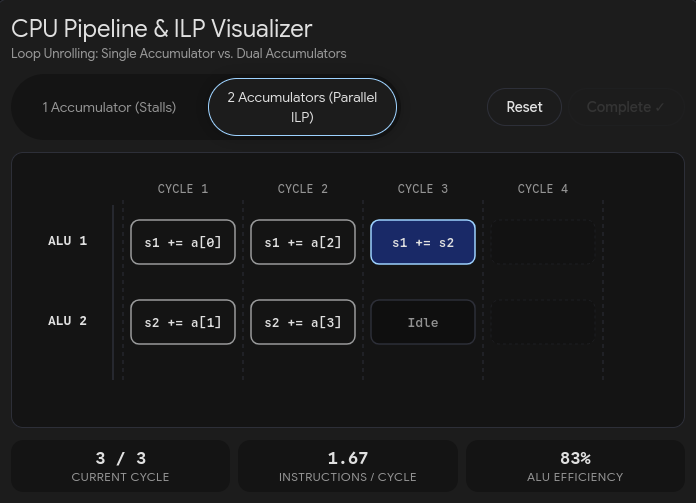
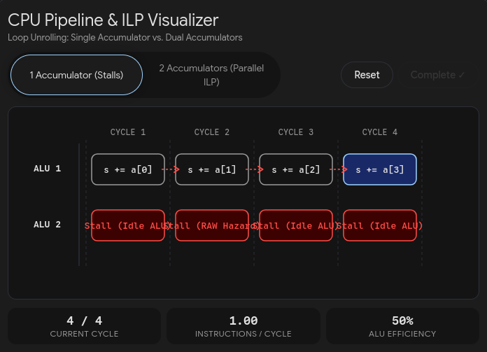

Phase 1:
- WSL:
    - windows subsystem for linux
    - let users run a real linux kernel directly inside Windows
- Hypervisor:
    - a software (lie between hardware and operating system) that can create and run VMs by splitting the current computer's resources into multiple isolated environments. 
- WSL and shared VMs give misleading timing for a job:
    - WSL2:
        - run linux inside a hidden virtual machine in Windows.
        - --> Windows decides when anything is run.
        - hardware counters are limited.
        - everything is just a virtualization --> Windows decide everything + our run on WSL will have overhead.
    - Shared cloud VMs:
        - put strangers on the same cache and memory bandwidth, and hypervisor can take the current VM's CPU time.
        - --> fighting for resources.
    --> noisy numbers we can't explain + performance variability.
- perf:
    - perf-events = event-oriented observability tool --> help for performance monitor and troubleshooting.
        - hardware events
        - software events
        - ... (many more kinds of events)
    - commands types:
        - listing events
        - counting events
        - profiling
        - static tracing
        - dynamic tracing
    - need symbols and stack traces to get the most out of perf.
        - symbols map raw memory addresses to readable functions and variable names.
    - stack traces:
        - always compile with frame pointers.
        - without it, we will see incomplete stacks from perf_events.
        - frame pointer = CPU register storing address of the stack frame of the current function.
    - dynamic tracing:
        - harder to use.
        - can be enabled on a live system without restarting anything.
    - we can visualize data from perf using flame graph.
    - perf can collect hardware counters, which are registers in CPU tracking low-level hardware events during program execution.
        - e.g. # of instructions executed, clock ticks, # of instructions per cycle, ...
    - perf needs to have permission to read hardware counters.
        - error: <not supported>
        - fix: drop the sudo requirement:
            cat /proc/sys/kernel/perf_event_paranoid        # probably 3 or 4
            echo 'kernel.perf_event_paranoid=1' | sudo tee /etc/sysctl.d/99-perf.conf
            sudo sysctl --system
            perf stat -e cycles,instructions ls            # should now work without sudo
    - CPU has different types of cores:
        - P-cores: powerful cores for high-performance computing.
            - every p-cores have its own L2 cache.
        - E-cores (atom): low-power cores for energy efficiency and basic tasks.
            - all e-cores share a L2 cache.
    --> a task can be run on different cores at different time --> can pin a task so that the perf profile is static.
- Instruction-level parallelism:
    - a single CPU core.
    - instruction pipelining:
        - to execute an instruction, CPU needs to do some works:
            - fetching a chunk of machine code from memory.
            - decoding it and split into instructions.
            - executing those instructions.
            - writing the results back into registers.
        - --> this whole sequence is long and can take many cycles.
        - --> to hide latency, modern CPUs use pipelining = after the instruction passes through the first stage, CPUs will process the next one right away.
    - main performance indicator for CPU = cycles per instruction (CPI)
    - in a traditional pipeline, stages are overlapped, and a new instruction can finish every single clock cycle.
        --> 1 cycle per instruction --> base CPI = 1.
    - we can achieve CPI < 1 by adding more execution units (resources) into one single core --> more instructions per cycle.
        - e.g. one core has 3 ALUs, 2 floating point units, ...
        - this is cheaper than adding more additional core.\
        - superscalar.
    - superscalar processor only works if instructions are independent.
    - CPU has a buffer to keep upcoming instructions, as soon as the required data for the instruction is ready and a processing unit is free, CPU will run it.
    - pipelining increases the throughput of the system but not the latency as an instruction still needs that amount of steps to be finished.
    - pipeline hazard:
        - when the next instruction can not execute on the following clock cycle.
        - structural hazard = when 2 or more parts of instructions need the same part of CPU.
        - data hazard = when the current instruction needs to wait for an operand to be computed from some previous step.
        - control hazard = when a CPU can't tell which instructions it needs to execute next.
        - solution - pipeline stall:
            - if an instruction is congested, stop all other instructions coming after it until it is resolved.
            - structural hazard = wait until the execution unit is ready.
            - data hazard = wait until the required data is computed.
            - control hazard = flush the entire pipeline and start over.
    - branching:
        - CPU will start to execute the branch that it guesses to be more likely to be run.
            - in order to be able to guess, out of all branches it ran before, it computes statistics about them and recognizes pattern overtime.
        - wrong prediction = control hazard = flush the whole pipeline.
        - correct prediction = pay almost nothing.
        - volatile in C++ = require the compiler to generate instructions that read from and write to memory on every single access.
        - branch prediction can happen as we breaks instructions into stages and use pipelining on them (even though instructions are fetched in a sequence).
        - branch prediction process:
            - CPU uses pipelining to fetch instructions.
            - when the CPU fetches a conditional branch instruction (e.g. if (...)), it will use educated guess to guess whether that if condition is true or false:
                - true = fetch the instructions inside that if block into the pipeline and execute them.
                - false = fetch the instructions inside the else block into the pipeline and execute them.
            - when the conditional branch instruction is fully executed:
                - if the result is true --> big win.
                - if the result is false --> flush the whole pipeline and fetch + execute instructions in the correct block.
    - branchless programming:
        - e.g.
            ```
                int sum = 0;
                for (int num = 0; num < 100; num ++)
                    sum += (num < 50) * num;
            ```
        - or we can use ternary operator: sum += (num < 50)? num : 0;
        - we can use predication to avoid costly branch misprediction.
            - but the CPU needs to compute both the "if" and "else" outcomes before picking the winner.
            - usually, the double work wastes ALU cycles.
        - branch prediction has control hazard, and predication has data hazard.
    - latency = how many cycles to finish one instruction.
    - throughput = how many instructions, on average, can be executed per cycle.
    - modern CPUs are superscalar ==> multiple execution units on a single core.
        - --> to speed up the process, we can divide the work across those execution units.
        - 
        - 